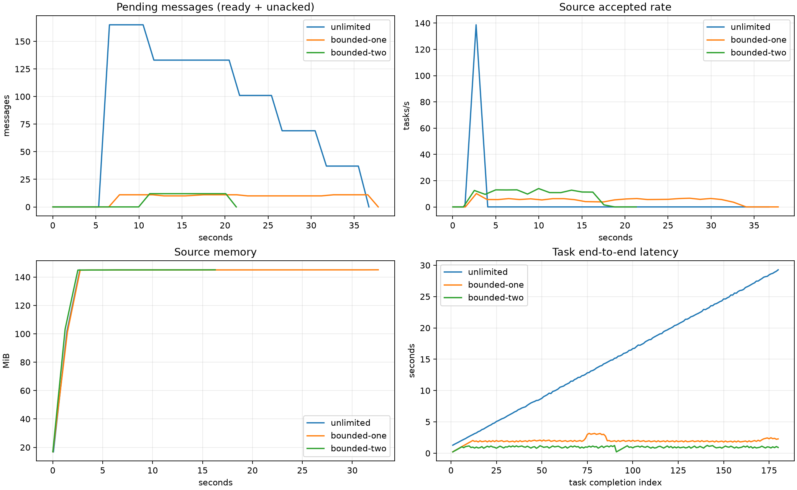
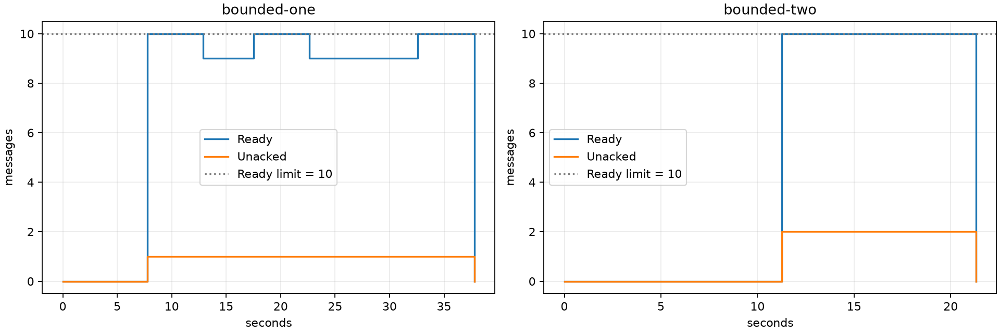
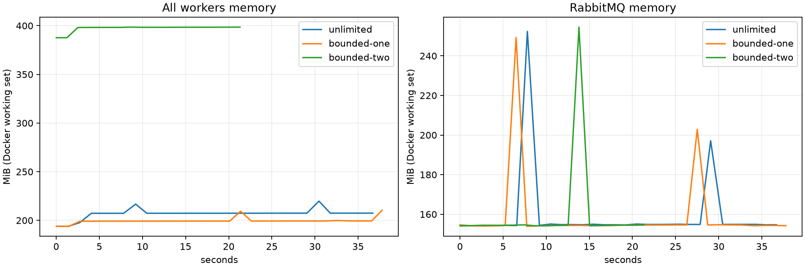

# MLOps: FastAPI, MLflow и RabbitMQ

Конвейер классификации Iris: API и пакетный источник публикуют задачи в RabbitMQ,
FastStream-воркер вычисляет предсказания и сохраняет результат в PostgreSQL.
Модель загружается из MLflow по alias `champion` один раз при запуске воркера.

## Запуск

Нужен Docker с Compose. При первом запуске создай `.env`:

```bash
cp .env.example .env
```

Укажи пароли PostgreSQL и RabbitMQ. Для существующего тома PostgreSQL пароль
должен совпадать с паролем сохранённой роли: изменение `.env` его не меняет.

```bash
docker compose up -d --build --wait db rabbitmq mlflow
docker compose --profile training run --rm train
docker compose up -d --wait app worker
```

Если модели уже обучены и образ собран:

```bash
docker compose up -d --wait --scale worker=1
```

| Сервис | Адрес |
| --- | --- |
| Swagger | http://127.0.0.1:8000/docs |
| MLflow | http://127.0.0.1:5001 |
| RabbitMQ Management | http://127.0.0.1:15672 |

MLflow опубликован на 5001, поскольку на этом Mac порт 5000 занят AirPlay.
Внутри Compose используются `mlflow:5000`, `rabbitmq:5672` и `db:5432`.
Очереди и таблицы создаются автоматически при старте приложения и воркера.

## Задачи через API

```bash
TASK_ID=$(python3 -c 'from uuid import uuid4; print(uuid4())')
curl -i http://127.0.0.1:8000/api/v1/tasks \
  -H 'Content-Type: application/json' \
  -H "Idempotency-Key: $TASK_ID" \
  -d '{"samples":[{"sepal_length":5.1,"sepal_width":3.5,"petal_length":1.4,"petal_width":0.2}]}'

curl -i "http://127.0.0.1:8000/api/v1/tasks/$TASK_ID"
```

POST возвращает **202**, UUID и `Location`. GET возвращает **200** с результатом,
метаданными модели и временем обработки; **404** — готового результата нет.
Это может означать ожидание, неизвестный UUID или ошибку, которую нужно искать в DLQ.
Некорректные признаки возвращают **422** до публикации в брокер.
Повтор той же задачи делается с тем же `Idempotency-Key`.

При перегрузке POST возвращает **503 + Retry-After**, без ожидания места и повторов.
Сетевое ожидание ограничено `PUBLISH_TIMEOUT=0.5`, число одновременных публикаций —
`API_MAX_INFLIGHT=32`. `Retry-After = max(1, ceil(INFERENCE_DELAY))` предлагает
подождать примерно один цикл обработки; свободное место не гарантируется.
Запись PENDING не создаётся. При потере publisher confirm исход публикации неизвестен:
повтор с тем же UUID безопасен благодаря уникальности результата в БД.

Из main сохранены синхронный `POST /process` и RAM-кэш моделей в API:
`GET /api/v1/model`, `GET /api/v1/model/cache`, `POST /api/v1/model/switch`.
Переключение версии в API влияет только на `/process`. Для обновления модели воркера
нужно изменить alias в MLflow и выполнить `docker compose restart worker`.
Служебные маршруты: `/healthz`, `/api/v1/health`, `/api/v1/version`.

## Источник и противодавление

```bash
docker compose --profile tools run --rm source mlops-source --count 100
```

Источник — отдельный процесс без фиксированной частоты публикации. Он хранит одну
текущую задачу, ждёт publisher confirm и при отказе повторяет её с задержкой.
Для своего CSV нужны колонки `sepal_length,sepal_width,petal_length,petal_width`:

```bash
docker compose --profile tools run --rm -v "$PWD/data:/data:ro" source \
  mlops-source --csv /data/input.csv --count 1000
```

`--batch-id UUID` вместе с тем же входом и порядком строк позволяет воспроизвести
те же UUID задач при повторном запуске. Автоматического checkpoint нет.

- Очередь: durable, `x-max-length=10`, `x-overflow=reject-publish`.
  Лимит относится к **ready** — сообщениям, ожидающим выдачи.
- Prefetch=1 и один поток на воркер ограничивают **unacked** — выданные,
  но ещё не подтверждённые сообщения. При двух воркерах их может быть два.
  Значение 1 выбрано потому, что каждый воркер выполняет только одну задачу
  одновременно; больший prefetch резервировал бы лишние сообщения перед пулом.
- Persistent-сообщения, publisher confirms и ack после commit дают at-least-once доставку.
  `task_id` — primary key; `ON CONFLICT DO NOTHING` предотвращает второй результат.
  `ack_policy=NACK_ON_ERROR`: нормальное завершение подтверждается после commit,
  неожиданный сбой приводит к повторной доставке. `ACK_FIRST` подтвердил бы задачу
  до записи, `ACK` — даже при ошибке, `REJECT_ON_ERROR` исключил бы повтор при временном сбое.
- Задержка и inference выполняются в пуле потоков, освобождая event loop.
- Ошибки модели повторяются внутри обработчика с удержанием unacked-слота.
  `task_attempts` хранит общий бюджет попыток, включая аварийные доставки.
- После трёх неудачных попыток задача публикуется в `predict.tasks.dlq` с причиной
  в заголовке `failure`; исходное сообщение подтверждается после DLQ confirm.
  Невалидный JSON сразу отправляется в DLQ.
- SIGTERM даёт до 60 с на завершение принятой работы; Docker ждёт 70 с.
  После SIGKILL незавершённая задача доставляется повторно.

Источник замедляется из-за отказов брокера — это backpressure. Ответ 503 внешнему
HTTP-клиенту сбрасывает нагрузку — load shedding.

Publisher confirms с `reject-publish` дают сигнал об отказе в самой операции публикации.
`drop-head` отбрасывал бы старые задачи; фиксированная частота не адаптировалась бы
к добавлению воркера. Опрос Management API давал бы запаздывающую проверку и гонку
между измерением очереди и публикацией. Поэтому источник использует broker nack,
а Management API применяется только для наблюдения в эксперименте.

```bash
docker compose up -d --no-deps --wait --scale worker=2 worker
docker compose exec rabbitmq rabbitmqctl list_queues name messages_ready messages_unacknowledged consumers
docker compose logs -f --tail=30 worker
```

Возврат к одному воркеру: `docker compose up -d --no-deps --wait --scale worker=1 worker`.

## Проверки

Для разработки и тестов нужен uv. Полный pytest использует Docker через Testcontainers.

```bash
uv sync --locked
uv run pytest --cov --cov-report=term-missing
uv run ruff check .
uv run ruff format --check .
python3 scripts/smoke.py
```

`smoke.py` проверяет полный путь одной задачи; этот же скрипт используется в CI/CD.
Тесты без контейнеров: `uv run pytest -m 'not integration'`.

## Сравнение backpressure

```bash
uv run python scripts/experiment.py --count 180 --delay 0.15
```

Скрипт сравнивает три режима на отдельных очередях и возвращает обычный worker.
Не запускай его одновременно с ручным изменением конфигурации.
CSV с наблюдениями, итоговый JSON и графики находятся в [results/experiment](results/experiment).
Статистика RabbitMQ обновляется с задержкой, поэтому короткие пики могут не попасть в отсчёты.

Измерения 22.10.2026: по 180 задач, искусственная задержка 0,15 с, все 540 завершены.

| Режим | Max ready / unacked | Источник / воркер в установившемся режиме, задач/с | Среднее / P95 total, с | Пик памяти источника / воркеров, MiB |
| --- | --- | --- | --- | --- |
| Без ограничений, 1 воркер | 0 / 165 | 0 / 6,36 | 15,22 / 27,87 | 145,00 / 219,78 |
| Ограничения, 1 воркер | 10 / 1 | 5,58 / 5,52 | 1,96 / 2,97 | 145,12 / 210,52 |
| Ограничения, 2 воркера | 10 / 2 | 12,05 / 11,82 | 0,96 / 1,15 | 145,11 / 398,53 |

Без ограничений источник отправил batch раньше, чем начался общий установившийся
интервал: его скорость на этом интервале равна нулю. В средней части самой публикации
она составляла 781 задачу/с, но backlog накопился в unacked и увеличил задержки.
С ограничениями скорость источника согласовалась с обработкой. Второй воркер
примерно удвоил пропускную способность; память воркеров в таблице суммируется.







## Документация

- [Данные, обучение и MLflow](docs/MLFLOW.md).
- [Ответы на вопросы из задания](docs/DEFENSE.md).
- [RabbitMQ и используемые инструменты](docs/TOOLS_GUIDE.md).

Остановка с сохранением данных: `docker compose down`.
`docker compose down -v` удаляет тома PostgreSQL, RabbitMQ и модели MLflow.
